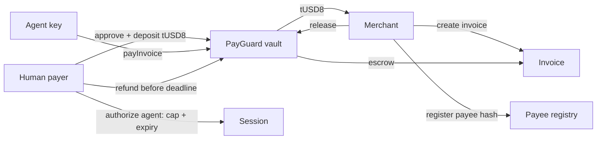

# PayGuard — Budgeted Agent Payments on Aevum

Public repository: <https://github.com/tuco8/payguard-aevum> · Deployed source commit: `26bb13d921c33f403db02abc312a8bfc931e9e5e`

PayGuard is a stablecoin payment vault for the **Aevum Builder Challenge #1**. It lets a human pre-fund a tUSD8 balance, grant a time-boxed and capped budget to an agent key, and let that agent pay only a payee whose identity hash has been registered on-chain. Funds remain in escrow until the merchant releases them or the payer refunds before the settlement deadline.

This project targets the **Invoice Payments**, **Confirmation of Payee**, and **Native AI Assistants** tracks at once.

## Why this is useful

AI agents and automated payment bots need to spend money, but handing them a wallet with unrestricted access is dangerous. PayGuard separates **custody** from **execution**:

- The human keeps the funds and can withdraw or revoke at any time.
- The agent receives only a scoped spending session: cap, expiry, and named payee.
- The merchant must register a payee identity hash before an invoice can be paid.
- Payments are idempotent; an invoice can be paid only once.
- Escrow has a deterministic release/refund path, so funds cannot be stuck forever.

## Architecture



### Core state

- `balanceOf[payer]`: tUSD8 deposited into PayGuard but not yet escrowed.
- `_sessions[payer][agent]`: budget, spent amount, expiry, and active flag.
- `payeeRegistry[merchant]`: registered identity hash for Confirmation of Payee.
- `_invoices[id]`: payer, merchant, amount, hashes, deadlines, and status.

### Invoice lifecycle

`Created → Paid → Released` or `Created → Paid → Refunded`, with `Cancelled` available before payment.

## Network and official references

| Item | Value |
| --- | --- |
| Network | QDay Aevum Testnet |
| Chain ID | `44005` (`0xABE5`) |
| RPC | `https://rpc-test.qday.info` |
| Explorer | <https://explorer-test.qday.info> |
| Native gas token | tQDAY |
| tUSD8 contract | `0x456569838f1d43009A91ebA4263147Afd7233483` |
| tUSD8 decimals | `6` |
| Web faucet | <https://faucet.qday.info/en> — requires mainnet ETH/USDT/USDC eligibility, so it is not usable for a zero-balance wallet |
| Discord faucet | Join <https://discord.gg/bYPhjmrSfK>, react ✅ in `#verify`, then run `/faucet <address>` — **1 tQDAY + 5 tUSD8**, no Ethereum mainnet balance needed, once per Discord account and once per address |
| Challenge page | <https://qday.io/builder-challenge> |
| Starter kit (PDF) | <https://drive.google.com/file/d/1QvkDX_lgbnKh4wZHc-gWMpWsn8YdHCOu/view?usp=sharing> |
| Starter kit (official repo) | <https://github.com/qday-io/aevum-starter-kit> — MIT licensed; includes EIP-3009 gasless checkout pattern |
| DoraHacks event | <https://dorahacks.io/hackathon/qday> |

## Getting test funds with no mainnet balance

The web faucet's eligibility API rejects wallets with no mainnet ETH/USDT/USDC. The official `aevum-starter-kit` README documents a Builder-Challenge-only alternative:

1. Join <https://discord.gg/bYPhjmrSfK> and react ✅ in `#verify` to unlock the challenge channels.
2. In a channel that accepts bot commands, run `/faucet 0xB6dE519D266F355C41fa4Dfe7b72112E30EF35AA`.
3. Confirm the deployer balance with `cast balance 0xB6dE519D266F355C41fa4Dfe7b72112E30EF35AA --rpc-url https://rpc-test.qday.info`.
4. After deployment, send a small amount of tQDAY from the deployer to the agent key so it can submit `payInvoice`.

Only testnet tokens are requested. Never send real funds or share private keys or seed phrases.

## Live deployment and verified run

| Item | Value |
| --- | --- |
| PayGuard | `0x55A357F9097Ab0C6F711EF23c46c6d32F0f1cFe2` |
| Explorer | <https://explorer-test.qday.info/address/0x55A357F9097Ab0C6F711EF23c46c6d32F0f1cFe2> |
| Deploy tx | `0x923e5fcbc6fcc858152aebf2cb6eaefa91bd0dd5acf232e2f9db3cc7639eb0d6` |
| Flow proven | deposit 5 tUSD8 → agent budget 5 tUSD8 → invoice 2 tUSD8 → agent pays → merchant releases |
| Final state | invoice `Released`; merchant received 2 tUSD8; payer keeps 3 tUSD8 in vault; agent has 3 tUSD8 budget remaining |

Full transaction hashes, explorer links, and RPC-verified state are in `EVIDENCE.md`.

## Local test results

Toolchain: Foundry `1.10.0`, Solidity `0.8.20`, EVM version `shanghai`. Aevum does not support Cancun opcodes; `foundry.toml` pins `evm_version = "shanghai"`.

```bash
forge test -vv
```

Result: **13 tests passed, 0 failed**.

Covered:

- happy-path pay and release
- double payment rejection
- unauthorized agent rejection
- session budget cap
- expired session
- expired invoice deadline
- payee hash mismatch
- zero-amount invoice
- refund before deadline
- refund after deadline rejection
- third-party release after settlement deadline
- immediate agent revocation
- withdrawal of unused balance

## Build and test

```bash
forge build
forge test -vv
```

## Deploy

Copy `.env.example` to `.env` and set throwaway testnet-only keys. The deployer must first receive 1 tQDAY from the Discord faucet above. Aevum's own tools send legacy (type 0) transactions, so add `--legacy`:

```bash
forge create src/PayGuard.sol:PayGuard \
  --rpc-url "$RPC_URL" \
  --private-key "$PRIVATE_KEY" \
  --legacy \
  --broadcast
```

The explorer verifier is not working yet; record the deployed address and a link to the exact source commit in the README/submission instead. The command below is kept for when the verifier returns:

Verify source on Blockscout:

```bash
forge verify-contract \
  --chain-id 44005 \
  --verifier blockscout \
  --verifier-url https://explorer-test.qday.info/api \
  <PAYGUARD_ADDRESS> \
  src/PayGuard.sol:PayGuard
```

## Frontend demo

`web/index.html` is a dependency-free static interface using ethers.js from a CDN and an injected MetaMask wallet. It exposes the full payer → agent → merchant flow with plain-language status messages and transaction hashes.

Open it with any static file server, for example:

```bash
python -m http.server 8080 --directory web
```

Then visit `http://localhost:8080`.

## Submission checklist mapping

| Requirement | Where |
| --- | --- |
| Public GitHub repository | This repository |
| Aevum integration | Deployed `PayGuard` contract on chain `44005` |
| Live deployment | Deployed contract + static frontend + recorded demo |
| Documentation | This README |
| Verifiable on-chain activity | Explorer links and tx hashes in `EVIDENCE.md` |
| No secrets in repo | `.gitignore` excludes `.env`; only throwaway testnet keys used locally |

## Evidence

See `EVIDENCE.md` for deployed addresses, transaction hashes, and demo recording link. These are filled in after the live testnet run; no submission or prize claim is implied by this repository alone.
